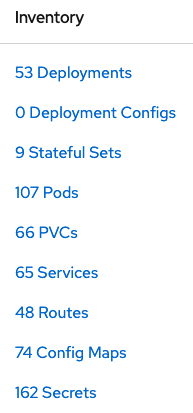
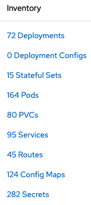
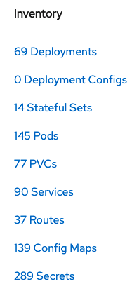

# Troubleshooting a Red Hat OpenShift on IBM Cloud (ROKS) Reservation

Last Updated: 2021-12-06

### Prerequisites:
  * a reservation for a Red Hat OpenShift on IBM Cloud (ROKS) cluster on Technology Zone
  * experience with OpenShift Container Platform (OCP) and the oc / ibmcloud CLIs
    * install the appropriate **Client-side requirements** from here: [V21.0.x](https://www.ibm.com/docs/en/cloud-paks/cp-biz-automation/21.0.x?topic=deployments-preparing-demo-deployment) or [V20.0.x](https://www.ibm.com/support/knowledgecenter/SSYHZ8_20.0.x/com.ibm.dba.install/op_topics/tsk_preparing_demo_.html)
  * experience with Cloud Pak for Business Automation (or willingness to learn!)

***

## Troubleshooting questions and answers

There are many possible issues, but here are a few that appear when deploying in the shared IBM Technology Zone reservation accounts:

### Q: What if my cluster has a Failed status or is forever Provisioning?

A: If your cluster moved from **Provisioning** to **Failed** status in [Technology Zone My Reservations](https://techzone.ibm.com/my/reservations) or is **Provisioning** for longer than 2-4 hours
  * refresh the page a few times to check
  * for **Provisioning** longer than 2-4 hours, it is recommended to check the next question (How do I find my cluster URL in IBM Cloud?) to see if that allows access to your cluster
  * leave any **Failed** tiles (it will go away after some weeks) and try to reserve again, possibly in a different data center
  * try to delete any tiles you no longer need if allowed to save IBM cost
  * for additional support on reservation errors in Technology Zone, please see the [Support](#support) section below.


### Q: How do I find my cluster URL in IBM Cloud?

A: If your confirmation email and/or My Reservation tile does not have a cluster URL (a known occasional issue), or maybe your tile is **Provisioning** for longer than 2-4 hours as in the above question, you can try the following:

  * go to Technology Zone's My Library -> My Reservations page
  * open the page for your reservation
  * locate an id with the format `itzroks-1a1a1a1a1a1-1a1a1` or `dteroks-1a1a1a1a1a1-1a1a1` or `ibmcloud-roks-1a1a1` and copy it
  * go to https://cloud.ibm.com/kubernetes/clusters?platformType=openshift and select the 2071092 - ITZ - SQUAD account (or any similar ITZ or DTE labeled account) in the upper right
  * filter the table using the id
  * If you still cannot find your cluster, please see the [Support](#support) section below.


### Q: I got a message in IBM Cloud stating I cannot access resources

A: If for any reason you get a message saying you cannot access resources in the IBM Cloud console
  * check the account in the upper right is set to 2071092 - ITZ - SQUAD (also check any similar ITZ or DTE labeled accounts) and try clicking the link again.
  * if you still cannot access the cluster, please see the [Support](#support) section below.


### Q: My cluster status in IBM Cloud is not Normal or I do not have an Ingress subdomain

A: If the status never reaches **Normal** or your **Ingress subdomain** is not set, check for up to 60 minutes after you can access your IBM Cloud cluster page.  Then, please see the [Support](#support) section below.


### Q: How do I know if the CP4BA operator is done deploying my pattern?

A: For **Demo Pattern Preinstalled Clusters**, the operator will take up to 8 hours to deploy.

  * **V21.0.x demo patterns**: The last task within the operator is to generate a config map named `icp4adeploy-cp4ba-access-info` which you can access in the OCP Console under **Workloads** -> **Config Maps** or via the CLI.  If this config map exists, then CP4BA should be ready.
  * **V20.0.3 demo patterns**: The last task within the operator is generally ADS so if this is deployed then we know CP4BA should be ready.  You can check what is deployed using the web console or CLI.

You can also refer to these approximate pod counts based on the preinstalled demo pattern configurations:

<details><summary>click to show images</summary>

#### V20.0.3 preinstalled demo pattern:


#### V21.0.1 preinstalled demo pattern:


#### V21.0.2 preinstalled demo pattern:


</details>


### Q: How do I check what is deployed in my cluster?

A: Here are some hints:

  * Using the web console:
    * go to Projects -> dtecp4auto or dtecp4ba
    * review the **Inventory** at the bottom left
    * click Pods and use the filter to search for pods by name such as `ads` or `bastudio`
  * Using the CLI (see [Prerequisites](#prerequisites) to install):
    * access the CLI at the upper right of the web console by clicking `IBM#<email>` -> `Copy Login Command`
    * click **Display token** and copy the line under **Log in with this token**
    * paste it into a terminal where the CLI is installed
    * execute some of the following commands:
      * `oc project dtecp4auto` or `oc project dtecp4ba`
      * `oc get pods` or `oc get pods | grep <search term>`
    * you may also follow the operator log:
      * execute `oc get pods | grep operator`
      * take the name of the operator pod and run `oc logs <operator-pod-name> -c operator -f`
      * your terminal will stream the operator logs


### Q: My storage is not binding correctly

A: There is an overall limit per Tech Zone account and per data center.  Everyone shares this limit across all users.
  * If you are installing on your own, it is best to modify the storage classes to use a reclaim policy of `DELETE` as `RETAIN` will not free the volumes under the PVs once your cluster is removed.
  * If you check your operator logs and see something similar to the following, please see the [Support](#support) section below.

    ```
    failed: Storage creation failed with error: {Code:E0003,
          Description:Failed to place storage order with the storage provider
          [Backend Error:Your order will exceed the maximum number of storage
          volumes allowed. Please contact Sales.], Type:StorageOrderFailed, RC:500,
          Recommended Action(s):Wait a few minutes, then try re-creating your PVC.
          If the problem persists, open an IBM Cloud support case.}
    ```

  * Some preinstalled cluster templates now use a common NFS share to reduce the number of volumes and if this does not provision well, please see the [Support](#support) section below.


### Q: Some of my components or web interfaces are not working or returning browser errors

A: The first operation to try is to check your pod status.  Check for hints to find out what is deployed on your cluster above in **How do I check what is deployed in my cluster?**

Once you get the list of pods, you will want to look for pods that are either in an error status of some sort or are `Running  0/1` and thus they are running but not ready.  You can then try to delete the pods (OpenShift will generally immediately recreate another) or scale the associated stateful set or deployment to 0 and back up to the previous value.


### Q: I see some pods that are in an Error state or are not Ready, what do I do?

A: It depends on a number of factors.

Here are some examples that should be OK:
  * If the pods begin with `iaf-zen-tour` that it is likely not an issue.  Go to your CP4BA project's pod list, filter on `iaf-zen-tour` and confirm there is at least one pod that is `Completed 0/1`.  If there is, the other pods in an `Error` state can be ignored or deleted.
  * If the pod begins with `icp4adeploy-pfs-dbareg` and is `Running 0/1` and therefore not ready, it appears this can also be ignored as long as it is `Running`.
  * If the pod begins with `icp4adeploy-bai-odm` and is in an `Error` state, it appears it can be ignored as event appear to flow from ODM to BAI.

If another pod is `Running` and not `1/1` (Ready), you can try to delete the pod and see if the new one that will be created will become ready.  If it does not, you will have to debug using the pod's Events of Logs.


### Q: I cannot start any workflows and either get an error that mentions UOW or an error response on start in Workplace?

A: It appears that a restart of all pods beginning with `icp4adeploy-workflow-authoring-baw-server` will resolve this.  In addition, once restarted, the Workflow Authoring BAW Server appears to process all requests previously submitted while it was not working so you may receive numerous processes/tasks all at once.


### Q: I cannot open the ODM interfaces and I am using V21.0.1 or earlier

> Note: this also applies to Workflow Process Service trial V21.0.2 on localhost

A: The route URL pattern and certificate format used in V21.0.1 and earlier will not open in all browsers (specifically Chrome on MacOS).  The workaround on MacOS is to save the certificate from your browser and import it into your MacOS Keychain Access:

  * click the icon to the left of the URL in the browser
  * click Certificate
  * drag the large picture of a "certificate" to your desktop or a finder window
  * open Keychain Access
  * click File -> Import Items...
  * open the certificate saved above
  * double click the certificate in the list
  * expand Trust
  * set the top drop down to Always Trust and approve it
  * refresh the original browser


### Q: Timeout/Error for create workflow project with case in BAS on demo pattern

A: Creating a workflow project in BAS with case enabled results in what appears to be a timeout after 60 seconds.  However, then refreshing and looking at the workflow project list after a short time, one will see the case project is created (can take seconds to minutes) and can also be successfully opened.  Creating a workflow project without case features enabled works without error or delay in opening.  This may only occur on ROKS or in demo patterns (uncertain).

A JIRA DBACLD-14770 was opened for this issue in October 2021.  The workaround is as above.


### Q: Workplace gives me an error on first load or takes a really long time to load

A: Workplace sometimes gives an error the first time it is loaded after installation (generally not after this).  This error can mention user profiles or it can also result in the task list never loading (grey placeholders moving left/right forever).  Generally, wait 60 seconds and if it does not load, then close the browser completely and open a new one to login again.  It may be easier to always load Workplace in a private/incognito browser window so it is easier to clear the cache/session.


### Q: Why are my events are not showing in BAI/BPC dashboards?

A: This has been seen in all V21.0.2 platforms (SaaS, ROKS, etc.) where events will not arrive from another capability (workflow, decisions, content, etc.) at a BAI/BPC dashboard.  When the cluster is checked, all pods appear to be working.  It seems the flink jobs within the flink pods are not working which can only be checked within the flink container or the flink dashboard, not the OCP CLI.

If the flink jobs are not running they must be restarted by using the appropriate job.  Further, not that flink in IAF has no HA as of CP4BA V21.0.2 even in the enterprise pattern and IAF is working to support Flink HA in a future release.

The following commands can help you confirm and resolve the issue:

```
####################################
NOTE: your pod names may be different than below depending on your specific install
####################################

# first start by getting a list of the flink jobs from the flink task manager pod

oc exec -it icp4a-bai-bai-flink-taskmanager-0 -- /opt/flink/bin/flink list

# then if there are jobs missing from the list (such as no bpmn or content or icm or odm, etc.) then you need to find the corresponding job and restart it

# find list of jobs, something like icp4adeploy-bai-bpmn

oc get jobs | grep bai

# restart the job

kubectl get job icp4a-bai-bai-bpmn -o json | jq 'del(.spec.selector)' | jq 'del(.spec.template.metadata.labels)' | kubectl replace --force -f -

# repeat for any other jobs missing using the pattern icp4a-bai-bai-<end of job pod> for the job name in the kubectl command
```

### Q: Why do I get an error when create an Automation Document Processing (ADP) project?

A: When in BAS and creating an Automation Document Processing (ADP) project, you may get an error similar to the following:

`Project initialization failed due to lack of an available database. Please contact your system administrator.`

Depending on your platform (a Preinstalled cluster on Technology Zone or a self-installed cluster using the demo or enterprise patterns), this error can occur if you no longer have a database available for ADP to use.  Specifically for demo pattern installation (such as Preinstalled clusters from Technology Zone), one database is precreated and loaded with sample data for Automation Document Processing (ADP) during installation and this database is used for the basis of the first document processing project created by a user in BAS.

By default, only one database and one document processing project is supported by the demo pattern.  To create more document processing projects, one would have to find the documentation for ADP and manually create and initialize additional databases which is not recommended for the demo pattern given the small database size (but might be possible).  The best option is to reserve/install a new demo pattern or reserve a new Preinstall cluster on Technology Zone.

Additionally, if a user creates a document processing project and deletes it on the demo pattern and then tries to create a new one, they may see the same error.  It is recommended to only create one document processing project on a demo pattern cluster and not delete it.


### Q: FIXED - Is my preinstalled demo pattern deployment stalled or not started (or how do I know if I had the known Db2 operator issue)?


## Support

IBMers:

  * If you have any questions specific to ROKS or reservation and infrastructure access, please slack [#itz-techzone-support](https://ibm-cloud.slack.com/archives/C0124J683GW) for assistance.
  * If you have any questions specific to CP4BA, support is on a best effort community basis and recommend that you send a slack to [#dba-techsales](https://ibm-cloud.slack.com/archives/CBSQ40JSW) for assistance.

Business Partners:

  * If you have any questions specific to ROKS or reservation and infrastructure access, please email [techzone.help@ibm.com](mailto:techzone.help@ibm.com) for assistance.
  * If you have any questions specific to CP4BA, please use PartnerWorld to access IBM Support and open a case for assistance.
